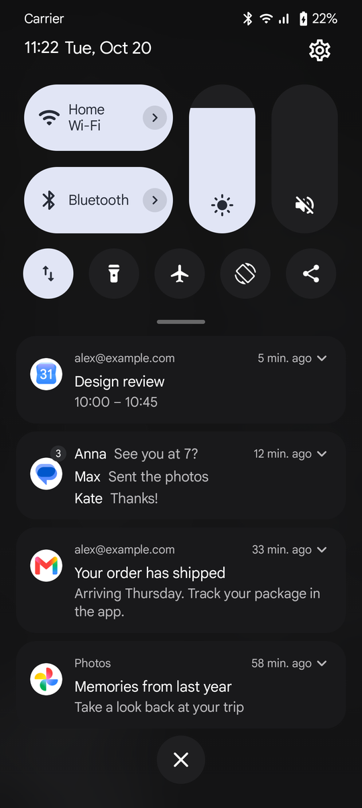
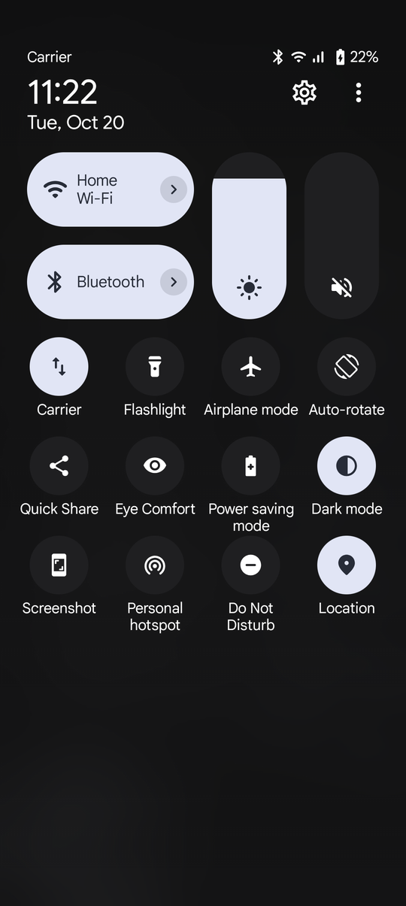
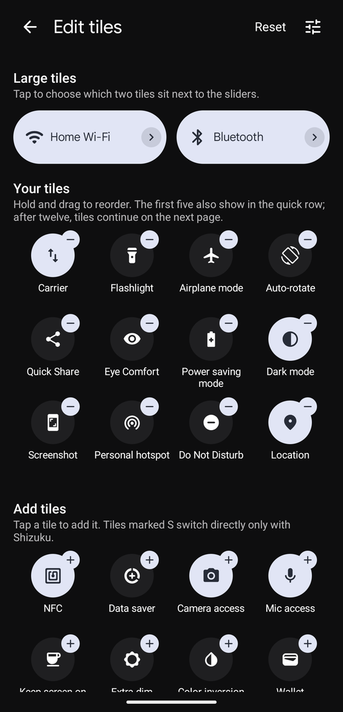
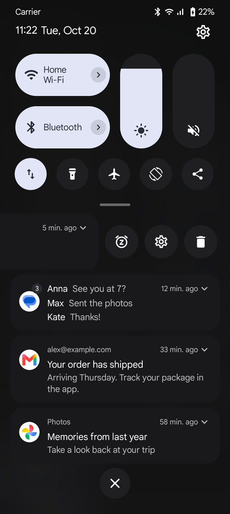
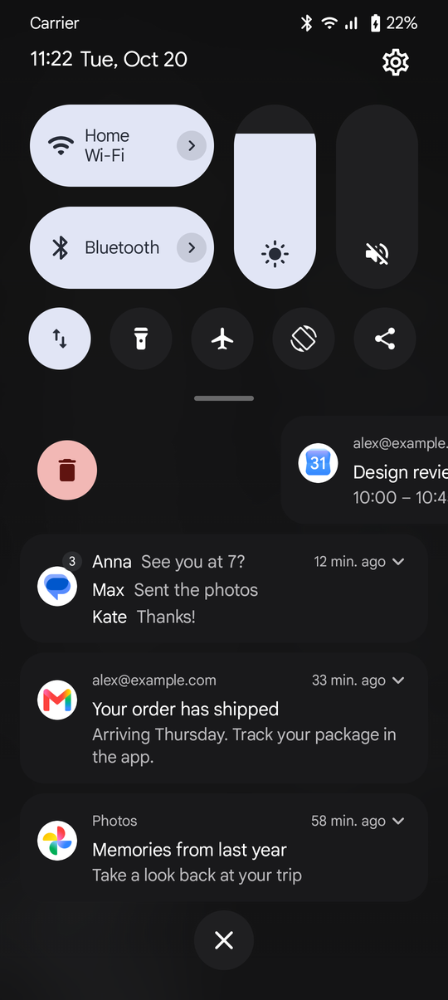
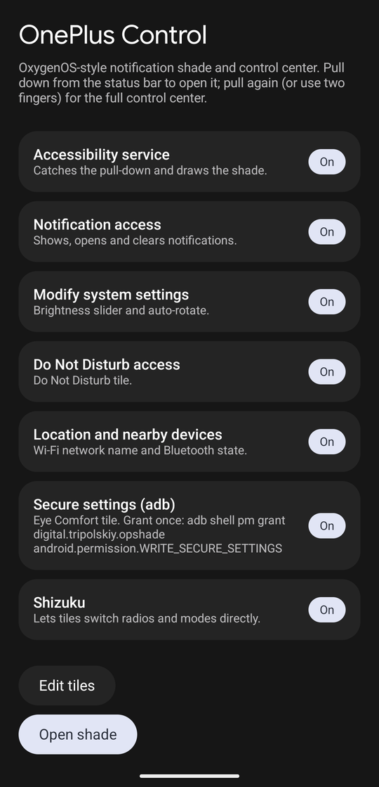

# OnePlus Control

**English** · [Русский](README.ru.md)

The OxygenOS 16 notification shade and control center, rebuilt for Google Pixel. It needs no root. It was built and tested on a Pixel 10 Pro running Android 17.

<table>
  <tr>
    <td></td>
    <td></td>
    <td></td>
  </tr>
  <tr>
    <td align="center">Notifications and the quick row</td>
    <td align="center">Control center</td>
    <td align="center">Tile editor</td>
  </tr>
  <tr>
    <td></td>
    <td></td>
    <td></td>
  </tr>
  <tr>
    <td align="center">Swipe left: remind me, settings, delete</td>
    <td align="center">Swipe right: delete</td>
    <td align="center">Setup</td>
  </tr>
</table>

## Features

- **Two-stage panel, as in OxygenOS.** The first pull shows notifications, the quick row of tiles, the Wi-Fi and Bluetooth tiles, and the brightness and volume sliders. Pull again, or start with two fingers, for the full 4×3 control center. The quick row flies into the grid as it opens.
- **Tall brightness and media-volume sliders.** You drag them relative to where you touch, as on OxygenOS, not jump-to-touch. They stretch a little past the ends and tick with haptics. Tap the icon to toggle auto brightness or mute.
- **Tiles** for Wi-Fi, Bluetooth, mobile data, flashlight, airplane mode, auto-rotate, Quick Share, Eye Comfort (Night Light), power saving, dark mode, screenshot, hotspot, Do Not Disturb, location, NFC, data saver, camera access, mic access, keep screen on, extra dim, colour inversion, Wallet, alarm, timer, calculator and camera. Any app can also be added as a shortcut tile.
- **Tile editor.** Drag to reorder, add or remove tiles, pick the two large tiles. With more than 12 tiles the grid gets extra pages you swipe through.
- **Media players, as on Pixel.** A swipeable carousel with one card per player:
  - the album art fills the card, and the play button is tinted from it;
  - a wavy seek bar you can drag or tap, previous and next, and the app's own actions (such as −15 s / +30 s);
  - an output chip that names the current device and opens Pixel's own output switcher.

  The players sit at the top of the notifications and under the tiles in the control center. Media notifications don't repeat in the list.
- **Notifications.** They are grouped and in ranking order. The expand arrow shows only when there is more to see. Expanding reveals the full text, the conversation, big pictures and action buttons, also for each notification inside a group. **Reply** opens a reply panel with the keyboard. Progress bars show in every state. Clear all removes everything. Swiping works as on OxygenOS:
  - **right** deletes, and a red badge shows when letting go will delete;
  - **left** opens *remind me in 1 hour*, *notification settings* and *delete*; dragging further stretches the delete button.
- **Pixel colours.** Everything uses Material You colours (wallpaper colours, light and dark), mapped to the same roles Pixel's own shade uses.
- **120 Hz.** Animations never recompose, and the shade window asks for the panel's full refresh rate.

## How it was made

OnePlus's SystemUI can't run on a Pixel: it depends on the OPlus framework and must be signed with the platform key. So it was used as a specification, not ported.
- The layout was measured on a OnePlus 12 (OxygenOS 16, CPH2581_16.0.10.501) from screenshots and `uiautomator` view dumps. It is written in "OnePlus dp" (a 360dp-wide screen) and scaled to the current width.
- Motion numbers (springs, thresholds, delays) were read from the decompiled `SystemUI.apk` (`OplusQSAnimator`, `OplusQsToggleSliderLayout`, `NotificationMenuRowExtImpl`).
- No OnePlus code, images or fonts are included. The raw captures are not in the repository because they contain personal data.

## Install

Requirements: Android 13 or newer (developed on Android 17), a computer with the Android SDK and adb, and USB debugging turned on.

```bash
./gradlew assembleRelease
adb install -r app/build/outputs/apk/release/app-release.apk
# Optional, for smoother first runs: compile ahead of time.
adb shell cmd package compile -m speed -f digital.tripolskiy.opshade
# For the Eye Comfort and extra dim tiles.
adb shell pm grant digital.tripolskiy.opshade android.permission.WRITE_SECURE_SETTINGS
```

Open **OnePlus Control** and turn on everything in the list: the accessibility service, notification access, modify system settings, Do Not Disturb access, and location and nearby devices.

### Shizuku (optional)

Android doesn't let apps switch Wi-Fi, Bluetooth, mobile data, airplane mode, dark mode, power saving, location, NFC, data saver, camera access or mic access. With [Shizuku](https://shizuku.rikka.app/) running, these tiles switch directly. Without it, they open the matching system panel.

1. Install Shizuku from Google Play.
2. Start it, either from the app with wireless debugging or over USB:
   ```bash
   adb shell "$(adb shell pm path moe.shizuku.privileged.api | sed 's/package://; s/base.apk//')lib/arm64/libshizuku.so"
   ```
3. On the OnePlus Control setup screen, tap **Shizuku** and allow access.

Shizuku stops when the phone restarts, so start it again after each reboot.

## How it works

- `ShadeService` is an accessibility service with two overlay windows: a thin catcher over the status bar and the full-screen shade (Jetpack Compose, with blur behind).
- **The system takes the top swipe.** On recent Android, SystemUI watches top-edge swipes with a spy input window and takes the pointer away once it recognises one. When that happens the catcher gets `ACTION_CANCEL`. The service then opens its own shade, which is layered above the system one, and dismisses the system shade. So the first pull opens the panel by itself rather than following the finger. Inside the panel every gesture belongs to the app.
- **Live Update chips.** The catcher also keeps taps on the status bar chips of promoted notifications (Android 16+ Live Updates, e.g. a running timer) from reaching SystemUI, so a short tap left of the camera cutout sends the newest promoted notification's content intent, as tapping the chip would.
- `ShadeController` holds the expansion: 0 is closed, 1 is notifications with the quick row, 2 is the full control center. It moves on critically damped springs.
- `NotifListener` is a `NotificationListenerService`.
- `Tiles.kt` and `TilesExtra.kt` have one class per tile. `TileCatalog` lists them, and `TileLayoutStore` saves the layout.
- **Smoothness.** Animated values are read only inside `offset {}`, `layout {}` and `graphicsLayer {}` lambdas, so a frame never recomposes. The window votes for the panel's top refresh rate, because Pixel's adaptive refresh rate otherwise caps the "high" category at 90 Hz.
  - On the release build, about 1% of frames are late and every frame lands 8.3 ms apart (120 Hz). Check with `adb shell dumpsys gfxinfo digital.tripolskiy.opshade`.
  - Debug builds of Compose are several times slower, so judge smoothness only on release builds.
- **Sample notifications** for checking cards: a chat with Reply, a picture, a download and long text with buttons. Turn them on with `adb shell am start -n digital.tripolskiy.opshade/.SetupActivity --ez testnotifs true`, and pass `false` to remove them. Their buttons only reach the app itself.
- **Screenshot mode** shows sample notifications and neutral Wi-Fi and carrier names:
  ```bash
  adb shell am start -n digital.tripolskiy.opshade/.SetupActivity --ez demo true
  ```
  Pass `false` to turn it off.

## Limits

- The lock screen keeps the system shade. The catcher is removed while the device is locked, which also keeps notification contents protected.
- Other apps' own quick-settings tiles can't be shown, because binding a `TileService` needs a permission only the system holds. Use app shortcut tiles instead.
- The hotspot and Quick Share tiles open the system screens.
- Heads-up notifications, the media player panel and inline reply are not done yet. The light theme hasn't been checked on a device.
- In fullscreen apps the catcher still covers the top strip of the screen.

---

Not affiliated with OnePlus or Google. OnePlus and OxygenOS are trademarks of their owners.
